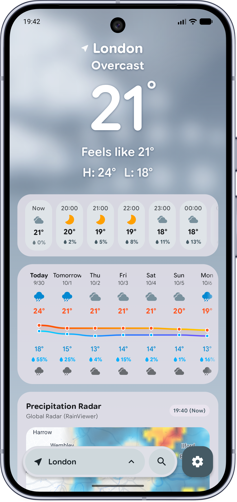
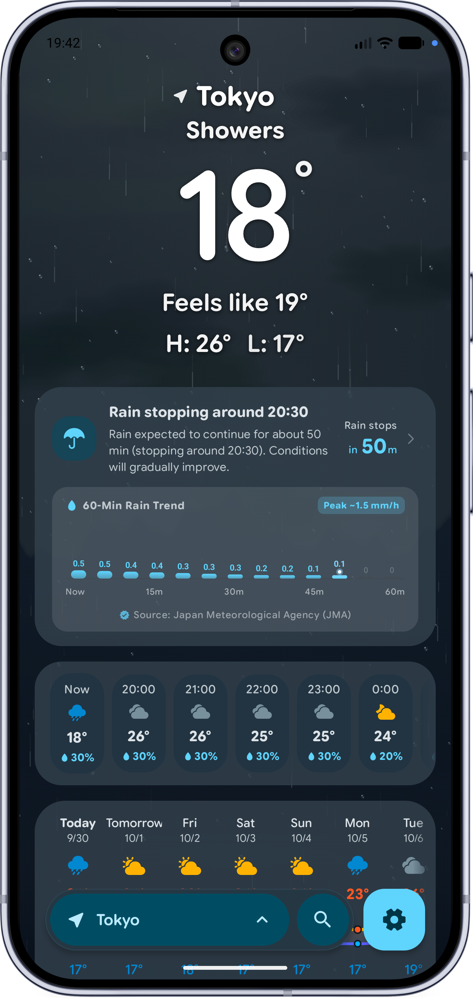
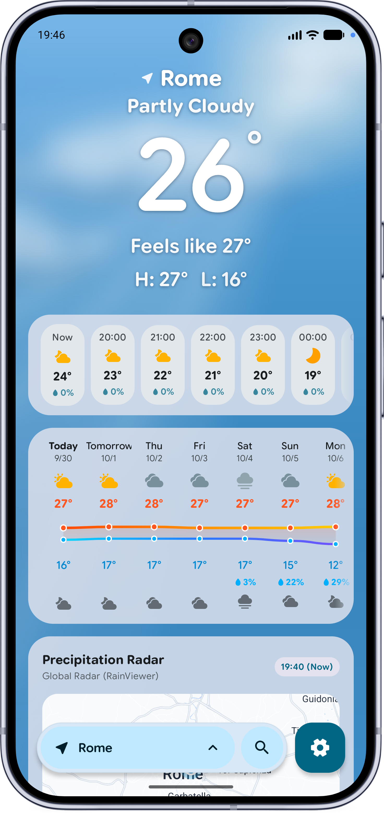
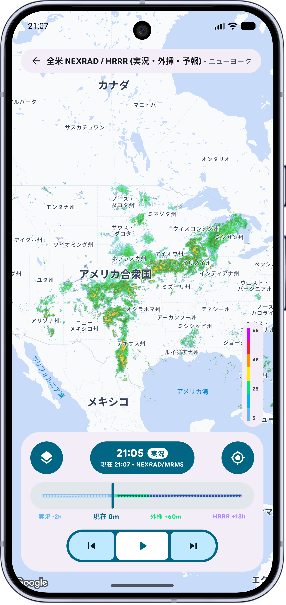
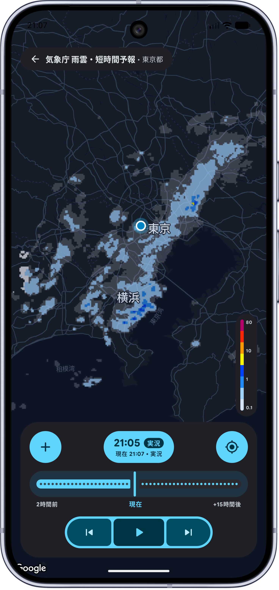

<div align="center">
  <br />
  
  <h1>Expressive Weather</h1>
  <p><strong>Material 3 Expressive デザインと高精度気象レーダー・多国間防災情報を統合したオープンソース Android 天気アプリ</strong></p>

  <p>
    <a href="README.md">🇺🇸 English README</a> ·
    <a href="PRIVACY_POLICY.md">プライバシーポリシー</a> ·
    <a href="THIRD_PARTY_NOTICES.md">サードパーティライセンス・出典</a> ·
    <a href="CONTRIBUTING.md">コントリビューションガイド</a>
  </p>

  <p>
    <a href="https://m3.material.io/">
      
    </a>
    
    
    <a href="LICENSE">
      
    </a>
  </p>
</div>

<br />

<div align="center">
  
  
  
  
  
</div>

<br />

---

## 概要

単なる数値予報の提示にとどまらず、端末の傾きセンサーと連動する雨粒・雪のエフェクト、気象庁の高解像度降水ナウキャスト・キキクル（危険度分布）・台風進路、全米 NEXRAD / MRMS / HRRR 気象レーダー、欧州 MeteoAlarm、世界気象機関（WMO）および GDACS の災害アラートを包括的に統合したオープンソース Android アプリです。

Android 16 の **Rich Ongoing Notifications（Live Updates）** に対応し、雨の降り始め・降り止みまでの残り時間をステータスバーやロック画面へ表示しつつ、5種類のホーム画面ウィジェットも備えています。

> **免責事項**: 本アプリは独立して開発された非公式のサードパーティ製オープンソースアプリであり、気象庁、国土地理院、NOAA/NWS、MeteoAlarm、WMO、GDACS その他いかなる公的機関とも関係ありません。災害・緊急時は必ず気象庁や自治体の公式発表をご確認ください。

---

## 配信フレーバー構成（Play Store 版 / GitHub 版）

本プロジェクトは Gradle の `productFlavors`（`distribution` ディメンション）により、同一の Application ID（`io.github.nemynew.expressiveweather`）で **Google Play Store 配信版 (`play`)** と **GitHub 公開版 (`github`)** をビルドし分けられる構成になっています。

| 項目 | `play`（Google Play 配信版） | `github`（GitHub Releases / 自前ビルド版） |
| :--- | :---: | :---: |
| Application ID | `io.github.nemynew.expressiveweather` | `io.github.nemynew.expressiveweather` |
| `REQUEST_IGNORE_BATTERY_OPTIMIZATIONS` 権限 | **除外**（Play ポリシー準拠） | 含む |
| 外部支援リンク（Buy Me a Coffee） | **非表示**（Play 決済ポリシー準拠） | 表示 |
| ウィジェット定期更新 | WorkManager 主体（Android Vitals 最適化） | WorkManager + 10分アラーム併用 |
| バックグラウンド位置情報の事前開示ダイアログ | 搭載 | 搭載 |

---

## ビルド & セットアップ方法

### 前提条件
- Android Studio（AGP 9.x / Kotlin 2.3 対応版）
- JDK 17
- Android SDK 36（Android 16）
- Google Maps API キー（Google Cloud Console で「Maps SDK for Android」を有効化したもの）

### 手順

1. **リポジトリのクローン**:
   ```bash
   git clone https://github.com/nemy-new/Expressive-Weather.git
   cd Expressive-Weather
   ```

2. **API キーの設定**:
   `local.properties.example` をコピーして `local.properties` を作成し、`MAPS_API_KEY` を設定します。
   ```properties
   MAPS_API_KEY=YOUR_GOOGLE_MAPS_API_KEY
   ```
   *本番用キーは Google Cloud Console 側で必ず「Android アプリ制限（`io.github.nemynew.expressiveweather` + 署名 SHA-1）」および「Maps SDK for Android のみ」に制限してください。*

3. **デバッグビルド**:
   ```bash
   # Play Store フレーバー
   ./gradlew assemblePlayDebug

   # GitHub フレーバー
   ./gradlew assembleGithubDebug
   ```

4. **リリースビルド**:
   署名設定は `keystore.properties`（`keystore.properties.example` 参照）または環境変数（`KEYSTORE_PATH`, `KEYSTORE_PASSWORD`, `KEY_ALIAS`, `KEY_PASSWORD`）から自動読み込みされます。
   ```bash
   # Play Store 提出用 App Bundle (.aab)
   ./gradlew bundlePlayRelease

   # GitHub Releases 配布用 APK (.apk)
   ./gradlew assembleGithubRelease
   ```

5. **ユニットテストの実行**:
   ```bash
   ./gradlew testPlayDebugUnitTest testGithubDebugUnitTest
   ```

---

## データソース & 出典

詳細な帰属表記・サードパーティライセンスは [THIRD_PARTY_NOTICES.md](THIRD_PARTY_NOTICES.md) をご覧ください。

- **数値天気予報・大気質**: [Open-Meteo](https://open-meteo.com/) ([CC BY 4.0](https://creativecommons.org/licenses/by/4.0/)・無料枠は非商用限定)
- **日本の気象レーダー & 防災情報**: 出典 [気象庁 (JMA)](https://www.jma.go.jp/)（高解像度降水ナウキャスト、雨雲の動き、キキクル、台風、気象警報・注意報）
- **日本域ウィジェット背景地図・ハザード**: 出典 [国土地理院 (GSI)](https://maps.gsi.go.jp/development/ichiran.html)
- **米国の気象レーダー & 気象警報**: [NOAA / NWS](https://www.weather.gov/) および [Iowa Environmental Mesonet (IEM)](https://mesonet.agron.iastate.edu/)
- **欧州の気象警報**: [MeteoAlarm](https://meteoalarm.org/) (EUMETNET)
- **国際気象・災害警報**: [WMO](https://severeweather.wmo.int/) および [GDACS](https://www.gdacs.org/)
- **広域気象レーダータイル**: [RainViewer](https://www.rainviewer.com/)
- **都市検索**: [Photon](https://photon.komoot.io/) by komoot (Data © [OpenStreetMap](https://www.openstreetmap.org/copyright) contributors, ODbL)
- **インタラクティブ地図**: Google Maps SDK for Android (Map data © Google)

---

## ライセンス

本プロジェクトは **Apache License 2.0** の下で公開されています。詳細は [LICENSE](LICENSE) および [THIRD_PARTY_NOTICES.md](THIRD_PARTY_NOTICES.md) をご確認ください。
