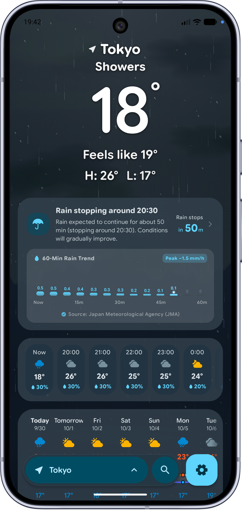

<div align="center">
  <br />
  
  <h1>Expressive Weather</h1>
  <p><strong>Material 3 Expressive デザインシステムと高精度気象レーダー・防災情報を統合した Android 天気アプリ</strong></p>

  <p>
    <a href="https://m3.material.io/">
      
    </a>
    
    
    <a href="LICENSE">
      
    </a>
  </p>
</div>

<br />

<div align="center">
  
  
  
  
  
</div>

<br />

---

## 概要

単なる数値予報の提示にとどまらず、端末のジャイロセンサーと連動する雨粒・ガラス屈折物理シミュレーション、気象庁の高解像度降水ナウキャストやキキクル（危険度分布）、全米 NEXRAD / MRMS / HRRR 気象レーダー、欧州 MeteoAlarm、世界気象機関（WMO）の公式警報などを包括的に統合しています。

Android 16+ の **Rich Ongoing Notifications（Live Updates）** に対応し、雨の降り始めや降り止みまでの残り時間をステータスバーやロック画面へ表示しつつ、バックグラウンドでの現在位置移動にも自動追従します。

---

## 主要機能

### 1. UI & インタラクションデザイン

* **ベントグリッド（Bento Grid）レイアウト**:
  * 気温・降水確率・風向風速・UV指数・日の出日の入り・気圧・視程などの気象データを、視覚的階層の明確なモジュール構造で配置。
  * `androidx.graphics.shapes` / Material 3 Expressive Shapes を用いた角丸・ポリゴンシェイプのダイナミックアニメーション。

* **多言語対応**:
  * 日本語、英語、簡体字中国語、繁体字中国語

---

### 2. 降雨予測 & Live Updates（降り始め・降り止みカウントダウン）

* **レーダー情報ソースの統合 (`PrecipitationAnalyzer`)**:
  * **直近 0〜60分**: 気象庁 高解像度降水ナウキャスト（5分間隔・予想降水量 mm/h）
  * **1時間後〜6時間後**: 降水短時間予報（10分間隔）
  * **6時間後〜15時間後**: 降水短時間予報（1時間間隔）
  * **15時間以降〜翌日**: 府県天気予報（6時間ブロック・降水確率 %）
  * 閾値解析（降り始め: 1.0mm/h, 降り止み: 0.1mm/h, 強雨: 10.0mm/h, 激しい雨: 30.0mm/h）により、「あと何分で雨が降り始めるか」「あと何分で雨が止むか」を高精度に算出。
* **Android 16+ Rich Ongoing Notification**:
  * ステータスバーピルに「雨止むまで あと25分」「雨雲接近 あと15分」などの短縮クリティカルテキスト（`shortCriticalText`）を常時掲示。
  * ロック画面および通知シェードでネイティブクロノメーターによる秒単位カウントダウンを提供。
* **バックグラウンド現在位置追従 (`PrecipitationLiveService`)**:
  * カウントダウン表示中は `foregroundServiceType="dataSync|location"` のフォアグラウンドサービスとして稼働し、OSによるスロットリングを回避。
  * 75m 以上の現在地移動を検知した瞬間、新地点の逆ジオコーディングと最新ナウキャスト再解析を実行。
  * 移動先で雨が止んだ場合は「雨が止みました」通知を表示して自動でサービスを正常終了。

---

### 3. 気象レーダー & 数値予報シミュレーション

* **日本国内（気象庁 JMA）**:
  * **高解像度降水ナウキャスト (HRPNS)**: 250mメッシュの降水強度実況・短時間予測。
  * **雨雲の動き**: 今後の雨雲の進退（最大+15時間先まで）の時系列シミュレーション。
  * **キキクル（危険度分布）**: 土砂災害・浸水害・洪水害の5段階危険度レイヤーを Google Maps 上に重畳描画。
* **アメリカ合衆国（NOAA / NWS）**:
  * **NEXRAD / MRMS**: 全米高解像度レーダー合成反射強度（dBZ）。
  * **HRRR (High-Resolution Rapid Refresh)**: 3kmメッシュ数値予報モデルによる最大+18時間の降水シミュレーション。
* **グローバル（RainViewer）**:
  * 日本・米国以外の世界各国における広域気象レーダータイル合成。
* **高速描画最適化**:
  * OkHttp による HTTP/2 コネクションプーリング、LRU メモリキャッシュ、および現在のマップ表示領域（Viewport）に絞ったタイルリクエスト制御。

---

### 4. 防災気象情報・多国間警報システム

* **日本（気象庁 JMA）**:
  * 気象庁防災情報 XML / JSON をパースし、市区町村ごとの5段階警戒レベル（レベル1: 早期注意情報 〜 レベル5: 緊急安全確保）を算出。
  * 特別警報・警報・注意報の発表状況、避難指示などの防災行動ラベルをカードおよび通知で掲示。
* **アメリカ（NOAA / NWS）**:
  * National Weather Service の CAP / GeoJSON API と連携し、Tornado Warning, Flash Flood Warning, Severe Thunderstorm Warning 等の重大警報を取得。
* **ヨーロッパ（MeteoAlarm）**:
  * 欧州39カ国（EUMETNET 加盟国・地域）の気象警報に対応。
  * ISO-3166-1 alpha-2 国コードおよび座標セントロイド判定による自動マッチング。
* **国際（WMO & GDACS）**:
  * **WMO Alert**: 世界気象機関公式の Common Alerting Protocol（CAP）警報。日本・米国・欧州以外の地域を自動カバーし、設定により常時併用も可能。
  * **GDACS**: 熱帯低気圧（台風・ハリケーン）、地震、洪水などの世界規模の大規模災害アラート。

---

## ビルド & セットアップ方法

### 前提条件
* Android Studio Ladybug (2024.2.1) 以降推奨
* JDK 17
* Android SDK 36 (Android 16 プレビュー / バニラアイスクリーム)
* Google Maps API キー（Google Cloud Console で「Maps SDK for Android」を有効化したもの）

### 手順

1. **リポジトリのクローン**:
   ```bash
   git clone https://github.com/your-username/expressive-weather.git
   cd expressive-weather
   ```

2. **API キーの設定**:
   プロジェクトのルートディレクトリに `local.properties` を作成（または既存ファイルを編集）し、Google Maps API キーを記述します。
   ```properties
   MAPS_API_KEY=AIzaSyYourActualGoogleMapsApiKeyHere
   ```

3. **ビルド & 実行**:
   ```bash
   # デバッグビルドの生成
   ./gradlew assembleDebug

   # 接続中の端末・エミュレータへインストール
   ./gradlew installDebug
   ```

4. **ユニットテストの実行**:
   ```bash
   ./gradlew testDebugUnitTest
   ```

---

## データソース & 出典

本アプリで利用している各種データおよび API は、以下のオープンデータ・公共機関・商用サービスより提供されています。

* **数値天気予報**: [Open-Meteo](https://open-meteo.com/) (Licensed under [CC BY 4.0](https://creativecommons.org/licenses/by/4.0/))
* **日本の気象レーダー & 防災気象情報**: 出典 [気象庁 (JMA)](https://www.jma.go.jp/)（高解像度降水ナウキャスト、雨雲の動き、キキクル危険度分布、気象警報・注意報）
  * ※本アプリは気象庁公式のアプリケーションではありません。
* **米国の気象レーダー & 気象警報**: [National Oceanic and Atmospheric Administration (NOAA)](https://www.noaa.gov/) / [National Weather Service (NWS)](https://www.weather.gov/) (Public Domain)
* **欧州の気象警報**: [MeteoAlarm](https://meteoalarm.org/) (EUMETNET)
* **国際気象警報**: [World Meteorological Organization (WMO)](https://severeweather.wmo.int/)
* **国際災害警報**: [Global Disaster Alert and Coordination System (GDACS)](https://www.gdacs.org/)
* **広域気象レーダータイル**: [RainViewer](https://www.rainviewer.com/)
* **都市検索 & ジオコーディング**: [Photon](https://photon.komoot.io/) by komoot (Data © [OpenStreetMap](https://www.openstreetmap.org/copyright) contributors, [ODbL](https://opendatacommons.org/licenses/odbl/))

---

## ライセンス

本プロジェクトは **GNU General Public License v3.0 (GPL-3.0)** の下で公開されています。詳細については [LICENSE](LICENSE) ファイルをご確認ください。
