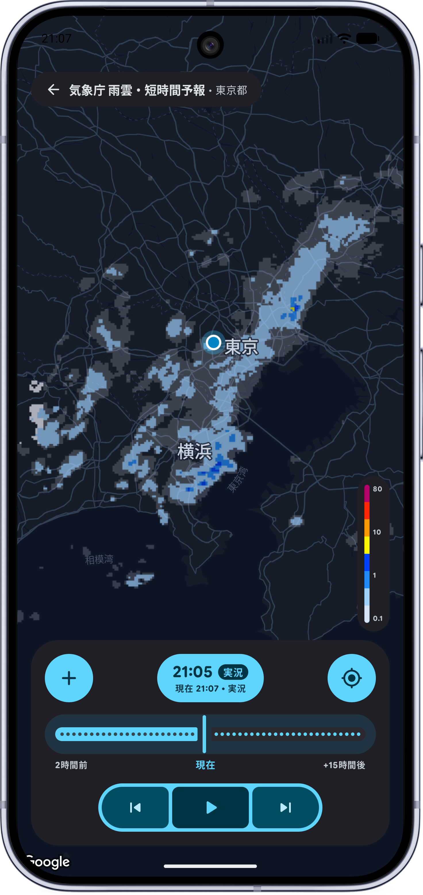

<div align="center">
  <br />
  
  <h1>Expressive Weather</h1>
  <p><strong>An open-source Android weather, radar, and multi-region severe weather alert app designed with Material 3 Expressive.</strong></p>

  <p>
    <a href="README.ja.md">🇯🇵 日本語 README</a> ·
    <a href="PRIVACY_POLICY.md">Privacy Policy</a> ·
    <a href="THIRD_PARTY_NOTICES.md">Third-Party Notices</a> ·
    <a href="CONTRIBUTING.md">Contributing</a>
  </p>

  <p>
    <a href="https://m3.material.io/">
      
    </a>
    
    
    <a href="LICENSE">
      
    </a>
  </p>
</div>

<br />

<div align="center">
  
  
  
  
  
</div>

<br />

---

## Overview

**Expressive Weather** combines expressive Material 3 UI, tilt-responsive rain/snow atmosphere effects, high-resolution regional weather radars (Japan JMA, US NEXRAD/MRMS/HRRR, Global RainViewer), and official severe weather warnings (JMA Kikikuru, NOAA/NWS, European MeteoAlarm, WMO, GDACS) into a single privacy-respecting Android application.

> **Disclaimer**: Expressive Weather is an **unofficial third-party open-source application** and is not affiliated with or endorsed by JMA, NOAA/NWS, MeteoAlarm, WMO, GDACS, or any government entity. In emergencies, always follow official announcements from local authorities.

---

## Key Features

- **Material 3 Expressive UI & Adaptive Atmosphere**:
  - Organic Material 3 Expressive shapes, dynamic theming, tilt-reactive raindrop & snow rendering, and tablet/foldable multi-pane layouts.
  - Localized in English, Japanese, Simplified Chinese, and Traditional Chinese.
- **Precipitation Countdown & Android 16 Live Updates**:
  - Combines high-resolution nowcasts and short-range forecasts (`PrecipitationAnalyzer`) to calculate minutes until rain starts or stops.
  - Supports Android 16 Rich Ongoing Notifications (`shortCriticalText` and live countdown) with optional location tracking.
- **Multi-Region Weather Radar & Typhoon Tracking**:
  - **Japan (JMA)**: 250m High-Resolution Precipitation Nowcast (HRPNS), +15h precipitation forecast, Kikikuru disaster risk layers, Himawari satellite, and typhoon tracks.
  - **United States (NOAA / IEM)**: NEXRAD / MRMS reflectivity and HRRR (+18h) numerical forecast layers.
  - **Global (RainViewer)**: Seamless composite radar tiles worldwide.
- **Multi-Region Disaster & Weather Alerts**:
  - **Japan**: JMA Warnings, Advisories, Emergency Warnings, and Kikikuru Alert Levels (1–5).
  - **United States**: NOAA / NWS CAP & GeoJSON active alerts.
  - **Europe**: MeteoAlarm alerts across 39 European countries.
  - **Global**: WMO official warnings & GDACS major disaster alerts.
- **5 Home-Screen Widgets**:
  - Compact (2×2), Medium Hourly (4×2), Large Dashboard (4×4), Material Shape (2×2), and Material You Rain Radar (4×2).

---

## Distribution Flavors (`play` vs `github`)

This project supports two Gradle product flavors under the `distribution` dimension using the unified Application ID `io.github.nemynew.expressiveweather`:

| Capability | `play` (Google Play Store) | `github` (GitHub Releases / Self-Build) |
| :--- | :---: | :---: |
| Application ID | `io.github.nemynew.expressiveweather` | `io.github.nemynew.expressiveweather` |
| `REQUEST_IGNORE_BATTERY_OPTIMIZATIONS` permission | **Excluded** (Play policy compliant) | Included |
| External donation links (Buy Me a Coffee) | **Hidden** (Play Payments policy compliant) | Shown |
| Widget background scheduling | WorkManager-only (Android Vitals friendly) | WorkManager + optional 10m alarm |
| Background location Prominent Disclosure | Included | Included |

---

## Build & Setup

### Prerequisites
- Android Studio (latest stable supporting AGP 9.x / Kotlin 2.3)
- JDK 17
- Android SDK 36 (Android 16)
- Google Maps API key with **Maps SDK for Android** enabled in Google Cloud Console

### Steps

1. **Clone the repository**:
   ```bash
   git clone https://github.com/nemy-new/Expressive-Weather.git
   cd Expressive-Weather
   ```

2. **Configure API key**:
   Copy `local.properties.example` to `local.properties` and set your `MAPS_API_KEY`:
   ```properties
   MAPS_API_KEY=YOUR_GOOGLE_MAPS_API_KEY
   ```
   *(For production keys, restrict the key in Google Cloud Console to Android app `io.github.nemynew.expressiveweather` + your SHA-1 signing certificate and Maps SDK for Android only.)*

3. **Build debug APKs**:
   ```bash
   # Google Play flavor
   ./gradlew assemblePlayDebug

   # GitHub flavor
   ./gradlew assembleGithubDebug
   ```

4. **Build release artifacts** (optional signing via `keystore.properties` — see `keystore.properties.example` — or env vars `KEYSTORE_PATH`, `KEYSTORE_PASSWORD`, `KEY_ALIAS`, `KEY_PASSWORD`):
   ```bash
   # Play Store App Bundle (.aab)
   ./gradlew bundlePlayRelease

   # GitHub Release APK (.apk)
   ./gradlew assembleGithubRelease
   ```

5. **Run unit tests**:
   ```bash
   ./gradlew testPlayDebugUnitTest testGithubDebugUnitTest
   ```

---

## Data Sources & Attributions

See [THIRD_PARTY_NOTICES.md](THIRD_PARTY_NOTICES.md) for complete attributions and license texts.

- **Forecasts & Air Quality**: [Open-Meteo](https://open-meteo.com/) ([CC BY 4.0](https://creativecommons.org/licenses/by/4.0/), non-commercial free tier)
- **Japan Radar & Warnings**: [Japan Meteorological Agency (JMA)](https://www.jma.go.jp/) (Unofficial client)
- **Japan Base Maps & Hazard Overlays**: [Geospatial Information Authority of Japan (GSI)](https://maps.gsi.go.jp/development/ichiran.html)
- **US Alerts & Radar**: [NOAA / NWS](https://www.weather.gov/) & [Iowa Environmental Mesonet (IEM)](https://mesonet.agron.iastate.edu/)
- **European Alerts**: [MeteoAlarm (EUMETNET)](https://meteoalarm.org/)
- **International Alerts**: [WMO](https://severeweather.wmo.int/) & [GDACS](https://www.gdacs.org/)
- **Global Radar**: [RainViewer](https://www.rainviewer.com/)
- **Geocoding**: [Photon](https://photon.komoot.io/) (Data © [OpenStreetMap](https://www.openstreetmap.org/copyright) contributors, ODbL)
- **Interactive Maps**: Google Maps SDK for Android (Map data © Google)

---

## License

Licensed under the **Apache License, Version 2.0**. See [LICENSE](LICENSE) and [THIRD_PARTY_NOTICES.md](THIRD_PARTY_NOTICES.md) for details.
